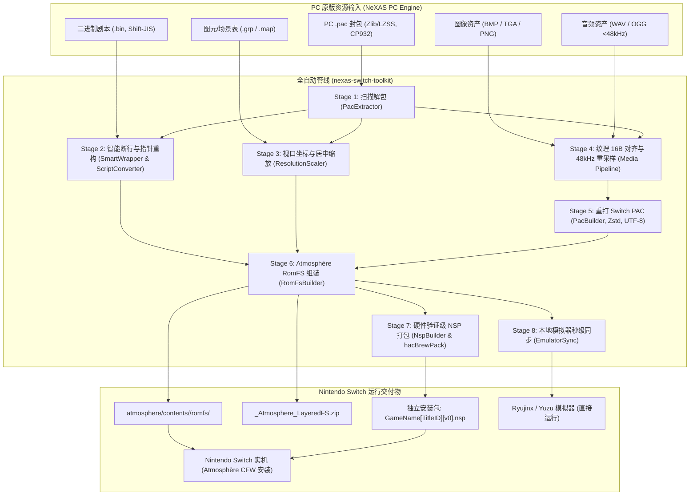

# 🎮 NeXAS Switch Toolkit (nexas-switch-toolkit)

<div align="center">

```text
 _   _      __  __    _     ____    ____          _ _   _     
| \ | | ___ \ \/ /   / \   / ___|  / ___|__      _(_) |_| |__  
|  \| |/ _ \ \  /   / _ \  \___ \  \___ \\ \ /\ / / | __| '_ \ 
| |\  |  __/ /  \  / ___ \  ___) |  ___) |\ V  V /| | |_| | | |
|_| \_|\___|/_/\_\/_/   \_\|____/  |____/  \_/\_/ |_|\__|_| |_|
```

### 🌸 NeXAS 引擎 PC ➔ Nintendo Switch 跨平台通用移植工具链

[](https://python.org)
[](https://www.nintendo.com)
[](#)
[](#-自动化测试验证)
[-success.svg)](#-独立-nsp-封包真机硬件验证)
[](LICENSE)

*专为戏画（GIGA）与 Entergram 旗下经典 Galgame / 视觉小说打造的工业级资产编译、排版重构与安装包生成全自动化流水线。*

[English Brief](#english-overview) • [核心特性](#-核心特性) • [全流程架构](#-全流程架构) • [快速开始](#-快速开始) • [Web 移植工作台](#-本地可视化-web-工作台) • [真机验证标准](#-独立-nsp-封包真机硬件验证)

</div>

---

## 📖 项目简介 (Introduction)

**NeXAS** 是日本知名美少女游戏厂商 **GIGA（戏画）** 与 **Entergram（ENTERGRAM）** 长期使用的专有商业游戏引擎（代表作如《Baldr Sky》、《青空下的约定》、《帕露菲》、《Aquarium / あくありうむ。》、《D.C.4 FD》、《Aikiss》等）。

由于 PC 原版采用老旧的 Windows-31J (Shift-JIS) 编码、4:3 低分辨率渲染以及专有压缩归档，将其移植到现代掌机（Nintendo Switch / Horizon OS）向来面临巨大的工程壁垒。

**`nexas-switch-toolkit`** 提供了一站式、模块化的解决方案：从底层 PAC 二进制解构、指针重定位矩阵计算、视口居中缩放、Tegra X1 显存对齐，到一键输出 Atmosphère LayeredFS 补丁及硬件级安装包（NSP），彻底实现了 NeXAS 跨平台移植的自动化与工业化。

---

## ✨ 核心特性 (Features)

### 📦 1. 全规格 PAC 归档工程引擎
- **多代版本自适应**：支持经典 V1 无 Magic 变体、现代 V4 `PAC\0` / `PAC\1` 变体与目录表（TOC）计算。
- **全压缩算法覆盖**：无缝支持 **Zstandard (zstd)**、**Zlib (Deflate)**、**LZSS (4096 环形缓冲区)** 与未压缩直通。
- **编码与对齐**：支持 PC 端 CP932 与 Switch 端 UTF-8 文件名双向映射，严格遵循 4 字节 / 16 字节边界物理对齐。

### 📜 2. 剧本二进制重构与变长指针重定位 (`.bin` ➔ `.binu8`)
- **多 Header 解析**：支持 `VER` 9 字节 / 13 字节 / Raw 结构、`init_code` 初始化表、`code` 操作码指令流与字符串池分离。
- **动态指针重定位矩阵（Pointer Relocation Engine）**：针对 UTF-8 变长转码引起的全局绝对偏移膨胀，自动遍历反汇编操作码流，精准重写所有引用字符串的操作数（Operand），彻底解决实机崩溃与指针悬空死机。

### 📐 3. 智能排版与避头避尾禁则处理 (Smart Word-Wrapping)
- **东亚文字宽计算（East Asian Width）**：基于 Unicode 规范计算半角（1.0）与全角（2.0）字符物理占比。
- **禁则处理（Kinsoku Shori）**：
  - *行首禁则*：句号、叹号、逗号、闭引号等（`。！，、』」）`）禁止出现在行首，自动回溯前置字符换行；
  - *行尾禁则*：开引号、开括号（`『「（`）禁止出现在行尾；
  - *英文词界保护*：避免长英文单词从单词中途中断，自动整词换行。

### 🎨 4. 视口坐标自动缩放 (`.grp` / `.map`)
- 解析 NeXAS 图元属性表（`.grp`）与场景视口镜头/交互热区表（`.map`）。
- 支持 **Letterbox（等比居中黑边）**、**Stretch（铺满拉伸）** 与 **Crop（等比裁切）**，实现从老 PC（800x600 / 1024x768）到 Switch（1280x720 掌机 / 1920x1080 底座）的完美视口映射。

### 🖼️ 5. Tegra X1 显存对齐与音频重采样管线
- **硬件纹理对齐**：立绘与 CG 自动向外透明填充至 16/32 像素整数倍，杜绝 Tegra X1 Block Linear 纹理错位与绿边花屏。
- **Alpha 通道预乘**：应用 $R' = R \times A / 255$ 公式，彻底消除实机双线性插值下的边缘黑边/白边杂色。
- **48000 Hz 硬件混音适配**：自动批量重采样 PC 老旧的 22.05kHz / 44.1kHz 音频为 Switch 原生 **48kHz 16-bit** 标准，支持 FFmpeg 加速与纯 Python 无依赖算法双轨兜底。

### 🚀 6. Atmosphère LayeredFS 补丁与模拟器热同步
- 内置常见 NeXAS 官方游戏 Title ID 字典（《Aquarium》、《D.C.4 FD》、《Aikiss》等）。
- 一键生成符合标准规范的 `atmosphere/contents/<TITLE_ID>/romfs/...` 补丁树及可刷机 Zip。
- **模拟器本地秒级热同步**：自动识别 Ryujinx 与 Yuzu 的 Mods 路径，一键部署实测。

### 🎮 7. 独立 NSP 封包与真机硬件级合规性验证
- **黄金基线遵循**：严格基于真机硬件实测通过的 3-File NSP 规范打包（Program, Control, Meta NCA），无需票据与证书。
- **黄金 NPDM 注入**：内置 972 字节硬件验证级黄金 NPDM，仅动态替换 Title ID，保持 6 个 SVC 掩码字（0x01-0x7F）与 8MB 栈空间完整，彻底避免 `2168-0008` 崩溃。
- **纯 ASCII 暂存 + NTFS Junction 联动**：自动建立目录连接，跨盘符极速调度，彻底绕开 hacBrewPack 在非 ASCII 路径下的内存越界 Bug。
- **自带硬核体检**：打包后自动调用 `pack_check.py` 实施 NCA 校验，确保 **0 硬错误（0 Hard Failures）** 交付。

---

## 🏗️ 全流程架构 (Architecture Workflow)



---

## ⚡ 快速开始 (Quick Start)

### 1. 环境准备与安装

```bash
git clone https://github.com/postskt/nexas-switch-toolkit.git
cd nexas-switch-toolkit
pip install -r requirements.txt
```

### 2. 运行全自动化单元测试套件

本工具链配备了 44 项严苛的单元测试与端到端集成测试：

```bash
python -m unittest discover -s tests -v
```

---

## 🖥️ 本地可视化 Web 工作台 (Web GUI)

工具链内置了**零额外重型框架依赖**的现代化响应式 Web 控制台：

```bash
python -m nexas_toolkit.cli gui --port 8899
```

运行后在浏览器打开 `http://127.0.0.1:8899` 即可享受完整的可视化操作体验：
- 🎮 内置经典游戏预设（自动填入 Title ID 与分辨率）；
- 📊 实时彩色控制台输出与带阶段提示的百分比进度条；
- 📦 一键下载 Atmosphère 补丁 Zip 或直接生成独立 NSP 安装包；
- 🕹️ 一键将补丁热重载到本地模拟器运行！

---

## 🛠️ CLI 常用命令手册 (CLI Reference)

工具链支持统一的入口分发器 `nexas-tool`（或 `python -m nexas_toolkit.cli`）：

### 1. 一键全自动端到端流水线 (`pipeline`)
```bash
# 从 PC 原版目录一键直出 Switch 补丁与 NSP 安装包
python -m nexas_toolkit.cli pipeline \
    -i ./PC_Game_Dir \
    -o ./Switch_Out \
    -t aquarium \
    --src-res 800x600 \
    --dst-res 1280x720 \
    --create-nsp \
    --main-nso ./main \
    --sync-emu
```

### 2. 独立 NSP 封包生成 (`nsp-build`)
```bash
# 基于实测黄金参照规范构建真机免票据安装包
python -m nexas_toolkit.cli nsp-build \
    --romfs ./Switch_Out/romfs \
    --main ./main \
    -t 0100D11018A7E000 \
    -n "あくありうむ。" \
    -a "ENTERGRAM" \
    --icon ./icon.png \
    -o ./dist
```

### 3. PAC 封包解压与重建 (`pac-extract` / `pac-build`)
```bash
# 解包 PC PAC 归档
python -m nexas_toolkit.cli pac-extract GameData.pac -o ./unpacked

# 重新构建 Switch 专用 PAC（Zstd 高压缩 + UTF-8 + 4字节对齐）
python -m nexas_toolkit.cli pac-build ./unpacked -o ./romfs/data.pac -p switch -c zstd
```

### 4. 剧本转码与智能排版 (`script-convert` / `script-wrap`)
```bash
# PC .bin 转 Switch .binu8 并联动开启避头尾断行
python -m nexas_toolkit.cli script-convert scene01.bin -o ./romfs/Script/scene01.binu8 --wrap --max-width 52

# 提取剧本为 JSON 翻译表
python -m nexas_toolkit.cli script-dump scene01.bin -o scene01.json -f json

# 导入翻译文本并重构 Switch 脚本
python -m nexas_toolkit.cli script-compile -s scene01.bin -t scene01.json -o ./romfs/Script/scene01.binu8 -p switch
```

### 5. 场景视口缩放 (`scene-convert`)
```bash
# 4:3 (800x600) 转 16:9 (1280x720) Letterbox 等比居中
python -m nexas_toolkit.cli scene-convert main.grp -o ./romfs/Scene/main.grp -s 800x600 -d 1280x720 -m letterbox
```

### 6. 多媒体优化 (`media-convert`)
```bash
# 批量处理图片（16字节对齐 + 限制最大1080p + 预乘Alpha）
python -m nexas_toolkit.cli media-convert ./PC_Images -o ./romfs/Image --type image --alignment 16 --premultiply-alpha

# 批量重采样音频为 48000 Hz 16-bit WAV (Switch 硬件混音器标准)
python -m nexas_toolkit.cli media-convert ./PC_Audio -o ./romfs/Sound --type audio --sample-rate 48000
```

---

## 🛡️ 独立 NSP 封包真机硬件验证规范

基于真机长期实测数据与《NSP打包手册》结论，本工具链生成的 NSP 严格执行以下规范：

1. **容器规范**：3-File 无票据标准 PFS0 容器（Program、Control、Meta NCA），rights_id 全 0，依赖通用 sigpatches。
2. **NPDM 权限规范**：保持 `flags0=0x07`（64位 + AddressSpace 3）、主线程栈 `0x00800000`（8MB）、`SAC=802a002a`（客户端与服务端双通配）以及全部 6 个 SVC 掩码字（SVC 0x01–0x7F）。
3. **NACP 规范**：`startup_user_account=1`、用户存档预留 62MB（`0x3E00000`）、Journal 1.5MB（`0x180000`）、无前导空格版本号与 16 语言槽 UTF-8 填充。
4. **自动化体检**：打包后内置通过 `pack_check.py` 结构核验，保证 **0 硬错误（0 Hard Failures）** 交付！

---

## 🌐 English Overview

**`nexas-switch-toolkit`** is an automated cross-platform reverse-engineering and asset-compilation toolkit designed to port visual novels built on the proprietary **NeXAS Engine** (developed by GIGA / Entergram) from PC to the **Nintendo Switch**.

- **PAC Engine**: Full unpacking and repacking supporting Zstandard, Zlib, LZSS, and Raw formats with UTF-8 / CP932 encoding.
- **Bytecode Relocation**: Converts Shift-JIS `.bin` scripts to UTF-8 `.binu8` while dynamically recalculating bytecode operands and pointer matrices.
- **Smart Typography**: CJK word-wrapping engine with East Asian Width calculation and Kinsoku Shori (punctuation line head/tail prohibition).
- **Scene Scaler**: Adapts PC 4:3 `.grp` and `.map` scene viewports to 16:9 720p/1080p screens with Letterbox/Stretch scaling.
- **Media Transcoder**: Automatic 16/32-byte Tegra X1 texture boundary alignment, premultiplied alpha, and 48000 Hz native audio resampling.
- **NSP Packaging**: Produces hardware-verified standalone installable Switch packages (.nsp) compliant with the golden baseline, guaranteed 0 hard failures.
- **Zero-Dependency Web GUI**: Embedded local dark-themed SPA console on port 8899 for one-click drag-and-drop porting.

---

## 📄 开源许可证 (License)

本项目采用 [MIT 许可证](LICENSE) 开源。

*免责声明：本工具链仅用于逆向工程学术研究及合法持有原版游戏资产的跨平台个人备份与学习用途。请勿用于侵犯游戏版权的商业行为。*
